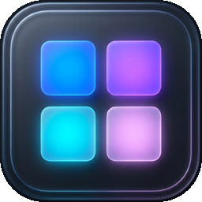

<div align="center">
  
  <h1>StackBar</h1>
  <p><strong>Native macOS &amp; iOS-style Taskbar Folders for Windows 10 &amp; 11</strong></p>
</div>

---

**StackBar** declutters your Windows taskbar by grouping rarely-used or categorized applications (*Gaming*, *AI & Dev*, *Creative*, *Web*) into sleek pop-up folders anchored directly above your taskbar icons.

## ✨ Highlights

- **Zero Runtime Dependencies**: Re-targeted to **.NET Framework 4.8** (pre-installed on every Windows 10 1903+ and Windows 11 machine). Runs directly out of the box without requiring the .NET Desktop Runtime or any external redistributables.
- **Single Standalone Executable**: Entire application, portable runtime, and installer wizard are packaged into a single ~700 KB binary with no auxiliary DLLs.
- **Portable Edition Supported**: Runs from a folder or USB drive and keeps its settings, shortcut copies, icons and logs in `./data/`, with no registry entries of its own.
  Stored paths are relative to `./data/`, and pinned stacks are tied to an ID kept in `./data/`, so moving the folder or getting a new drive letter doesn't break them.
  Outside `./data/` it only touches what you ask for: taskbar pins you create, and (with *Repair outdated app shortcuts* on) other apps' Start Menu / pinned shortcuts.
  Portable mode is switched on by the `.portable` file shipped in the zip (or by naming the exe `StackBar-Portable.exe`). It runs side by side with an installed copy without either touching the other's pins.
- **Separate Pinned Taskbar Folders**: Generates custom `.lnk` shortcuts per category with distinct `AppUserModelID`s (`StackBar.Group.<id>`), allowing you to pin multiple StackBar folders side-by-side on the taskbar.
- **60-Color Curated Accent Palette**: Select from an expanded 60-color palette (organized into 6 harmonious color rows: Reds, Oranges, Ambers, Limes, Emeralds, Teals, Cyans, Blues, Purples, and Pinks) with live preview on the flyout mockup.
- **Automatic Pinned Taskbar Sync**: Modifying a stack's icon, accent color, or app order automatically updates the shortcut in Windows' `User Pinned\TaskBar` and asks the taskbar to reload icons only when the stack's icon actually changed (no forced icon-cache flush), eliminating the need to unpin and re-pin.
- **Stack Deletion Safety & Cleanup**: Deleting a stack prompts for confirmation, removes its generated shortcuts and icons, and asks Windows to unpin it from the taskbar.
  If Windows refuses the unpin, Studio tells you to unpin it by hand, and clicking the leftover pin explains that the stack no longer exists.
- **iOS "Jiggle Mode" (Hold to Reorder / Delete)**:
  - **Long-Press or Right-Click**: Hold any app icon for 450ms (or right-click → *Rearrange / Edit Apps*) to enter Jiggle Mode.
  - **Dynamic Wobble Animation**: Icons oscillate gently with smooth hardware-accelerated animations.
  - **Ghost Tile & Live Reordering**: Dragging a tile shows a semi-transparent ghost tile under the cursor, and the other tiles slide out of the way to preview the landing slot.
    The new order is saved when you release the tile; pressing `Escape` during the drag cancels it.
  - **Delete `(✕)` Badge**: Tap the red badge on any jiggling icon to remove it from the stack with a confirmation prompt.
  - **Done Button / Esc**: Tap *Done* or press `Escape` to leave Jiggle Mode.
- **Intelligent Store App & Friendly Name Resolution**: Resolves technical package IDs (`com.lencx`, `Claude_pzs...`, `Microsoft.WindowsTerminal...`) to clean localized application names, and strips internal hex prefixes from imported shortcuts.
- **Typo-Tolerant Application Search**: Importer search features letter-collapse tolerance (e.g. typing "whatsap" matches "WhatsApp") and matches against both application display names and target package paths.
- **Offline On-Demand Launching**: Pinned taskbar shortcuts work even when StackBar is not running in the tray: clicking one starts StackBar and opens the flyout.
  Before the flyout appears StackBar only loads its settings (and, once after an upgrade, moves its shortcut copies to the new layout).
  Pin repair, refreshing outdated shortcuts and the one-time offer to import stacks from an older version run afterwards.
- **In-Place Flyout Renaming**: Click the folder title or the `✏` pencil next to it to rename the stack inline.
  Save with the `✓` button or `Enter`, cancel with the `✕` button or `Esc`.
- **Studio Quick-Edit Button**: Click the `⚙` button in the flyout header to open that exact stack in StackBar Studio.
- **Triple Icon Engine**:
  - **Custom Cover Icons**: Pick any `.ico`, `.png`, `.jpg`, `.exe`, or `.dll` file to represent your stack, or click the **★** star button on any app in the list to make its icon the folder's cover.
  - **Visual Emoji Selector & Presets**: Pick from a curated 40+ emoji palette dropdown or trigger the native Windows Emoji Panel (`Win + .`) with one click.
  - **iOS 2×2 Mini-Grid**: Automatically composites the first 4 apps inside a folder into a version-hashed 256×256 squircle `.ico` (bypassing Windows taskbar icon cache stalls).
- **4-Stage Icon Recovery Pipeline**: Combines `IShellItemImageFactory`, target `.exe` binary resolution, and `SHGetFileInfo` so Adobe apps, Steam games, and Store apps keep their icons.
  Transparency is preserved (no black corners), and icons stored at a specific index inside a `.dll`/`.exe` (e.g. `shell32.dll,-16`) are honored.
- **Real Folder Shortcuts**: Add normal filesystem folders (e.g. *Projects*, *Downloads*) into any stack. Clicking a folder launches Windows Explorer directly at that directory with clean 32-bit transparent folder icons.
- **Pixel-Perfect Caret Alignment**: The flyout is positioned in physical pixels on the monitor you clicked, so the caret points at the clicked taskbar icon even on mixed-DPI multi-monitor setups.
  The caret flips for a top taskbar and is hidden for left/right taskbars.
- **Persistent Shortcut Storage**: Imported shortcuts are copied to `%AppData%\StackBar\Links\<id>\<App Name>.lnk` (or `./data/Links` in portable mode), so unpinning an app from Windows doesn't break its StackBar item.
  The copy keeps the app's real name, so pinning an app you started from a flyout gives a normally named taskbar pin.
  Re-importing an app that is already in the stack is skipped.
- **Background Tray Daemon**: Sits in the Windows System Tray and listens on a user-scoped named pipe with foreground activation tokens. Rapid clicking toggles the flyout open/closed.
- **Multi-Source Importer**:
  - Pinned Taskbar icons (`.lnk` & `.url`)
  - `shell:AppsFolder` (Start Menu apps, Windows Store / UWP apps like Minecraft Launcher, Calculator)
  - Desktop shortcuts (including Steam `.url` game shortcuts)
- **Keyboard & Admin Shortcuts**:
  - Number keys `1`–`9` to launch apps instantly
  - `Ctrl + Shift + Click` or `Ctrl + Shift + 1..9` to Run as Administrator

---

## 📦 Installation

**Requirements:** Windows 10 (1903 or later) or Windows 11. Nothing else to install.

Download the latest build from the [Releases page](https://github.com/ilivinskyi/StackBar/releases).

### Option 1: Installer
Run `StackBar-Setup.exe`:
- Custom installation directory picker (defaults to `%LocalAppData%\Programs\StackBar`)
- Detects existing installations and switches to Update / Reinstall mode
- Creates Desktop & Start Menu shortcuts
- Configures background tray startup on login
- Registers in Windows *Installed Apps* with an automated uninstaller (pinned StackBar folders have to be unpinned by hand after uninstalling)

### Option 2: Portable Edition (No Install)
Extract `StackBar-Portable.zip` and run `StackBar-Portable.exe`:
- Runs entirely out of its local folder with zero installation.
- Saves all configs, copied shortcuts, and icons in a local `./data/` directory.

### Option 3: Build from Source
Requires the .NET SDK (Windows). The first build needs network access to restore NuGet packages.
```powershell
# Build StackBar.exe, StackBar-Setup.exe, and StackBar-Portable.zip to artifacts/
dotnet restore TaskbarGrouper.sln
.\build.ps1

# Run the unit tests (test-only NuGet packages; nothing is added to the shipped exe)
dotnet test tests\StackBar.Tests\StackBar.Tests.csproj
```

---

## 🛠️ Troubleshooting & Bug Reports

- **Blank white icon on the taskbar:** apps that update themselves in place leave their Start Menu / pinned shortcuts describing the old file, and Windows can then draw a blank icon for the app.
  StackBar refreshes those outdated shortcuts right before it launches an app (Studio → *Repair outdated app shortcuts*, on by default; each changed shortcut is backed up to `Backups\Shortcuts` in StackBar's data folder).
  Use *Repair App Shortcuts Now* in Studio to fix all of them at once. Shortcuts installed for all users need administrator rights and are skipped.
- **Logs:** `%AppData%\StackBar\logs\stackbar.log` (portable: `data\logs\stackbar.log`).
  Please attach the log when [opening an issue](https://github.com/ilivinskyi/StackBar/issues).
- **Settings:** `%AppData%\StackBar\groups.json`. A corrupt file is kept as `groups.corrupt-<date>.json` and the last good backup is restored.

---

## 🗂️ Project Structure

```text
├── src/
│   └── TaskbarGrouper/             # Main StackBar Windows Desktop Project (.NET Framework 4.8)
│       ├── Assets/                 # Multi-res app_icon.ico & app_icon.png
│       ├── Common/                 # Polyfills & string utilities
│       ├── Models/                 # AppConfig, AppGroup, GroupItem
│       ├── Services/               # ConfigService, ShortcutService, ShortcutRepairService, IconHelper, IpcService,
│       │                           # NativePositioningService, StartupService, InstallLocation, LaunchRules, AppInfo/AppLogger
│       ├── Themes/                 # Dark.xaml (Dark theme scrollbars, checkboxes, controls)
│       └── Views/                  # MainWindow (Studio), FlyoutWindow, TaskbarImporterWindow, SetupWindow
├── artifacts/                      # Created by build.ps1 (not committed)
│   ├── StackBar.exe                # Standard installed app binary
│   ├── StackBar-Setup.exe          # Installer, Updater & Uninstaller wizard
│   ├── StackBar-Portable/          # Portable standalone directory (isolated ./data/)
│   └── StackBar-Portable.zip       # Zipped Portable distribution
├── tests/
│   └── StackBar.Tests/             # xUnit tests (config, pins, shortcut repair, install safety, icons, placement)
├── build.ps1                       # Automated build & staging script
└── TaskbarGrouper.sln
```
